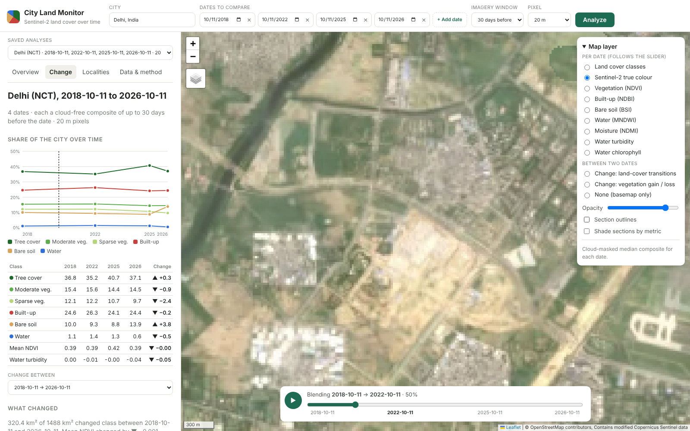

# City Land Monitor (Sentinel-2)

Type a city name, pick two or more dates, and see how the city's land cover changed between them,
from Sentinel-2 satellite imagery: vegetation, built-up/concrete, bare/undeveloped soil, open water
and water quality. The dashboard shows the whole city, and also each locality (Rohini, Saket,
Badarpur…), on a zoomable map with a timeline slider that blends from one date's image to the next.



## Run it locally

Needs Python 3.10+. You don't need any accounts or API keys, because the imagery comes from the free Sentinel-2 archive on AWS.

```bash
cd sentinel-city-dashboard
python -m venv .venv && source .venv/bin/activate      # Windows: .venv\Scripts\activate
pip install -r requirements.txt

python run.py serve                                     # open http://127.0.0.1:8000
```

The Delhi comparison shown in the screenshots ships in `results/`, so the dashboard opens with data.
To analyse something new, start typing a city, town or district in the top box and pick from the
suggestions (arrow keys and Enter work too), then set the dates (two by default: a year ago and today; use
**+ Add date** for more, up to 12) and press **Analyze**. You can also use the command line:

```bash
python run.py compare "Delhi, India" 2018-10-11 2022-10-11 2025-10-11 2026-10-11
python run.py compare "Delhi, India" 2024-03-15 2026-03-15 --window 60
python run.py analyze "Delhi, India" --start 2026-08-12 --end 2026-10-11   # one period only
```

Each date takes about 2 to 3 minutes at 20 m for Delhi (1,488 km²). Dates you have already analysed
are reused from `results/`, so adding one more date to an earlier comparison only costs that one date.

## What you get

| | |
|---|---|
| **Dates** | Pick any number of dates (2 by default, up to 12) from 2017 onwards. Each date gets a cloud-free composite of the imagery in the window before it (30 days by default). If a window is too cloudy, it widens automatically. |
| **Timeline slider** | Drag it, or press play, and the map blends the selected layer (land cover, true colour, NDVI, etc.) from one date to the next. The overview numbers follow the date under the slider. |
| **Change** | A chart and table of each class's share of the city at every date, plus the change from first to last. For any pair of dates you get class transitions in km² (vegetation to built-up, bare soil to built-up, vegetation cleared, greening, water gained or lost), a transition map and a vegetation gain/loss map. |
| **Suggestions while typing** | The city box suggests only areas: cities, towns, districts and neighbourhoods. It never suggests buildings, schools, roads or shops. Suggestions come from saved boundaries, an offline list of 34,000 cities and towns (`data/places/places.csv`), and OpenStreetMap Nominatim when it can be reached, keeping only area results. The locality search box suggests only ward sections and named localities, because landmarks such as airports, gates and offices are removed from its index. |
| **Search on the map** | A search box on the map finds localities in the city you have open. Type "Rohini" and press Enter: every Rohini section is selected, the map zooms there, and a popup shows its built-up, green, bare and water share with the change between the first and last date. The full analysis opens in the Localities panel. |
| **Localities** | 290 ward sections such as Rohini, Badar Pur and Lado Sarai, as well as districts, sub-districts and a 2 km grid. The search box also knows 115 named localities (Saket, Badarpur, Connaught Place, Dwarka…) and opens the section that contains each one. A name shared by several sections, such as "Rohini", combines them. Every section can be sorted and shaded by its value on a date or by its change. Clicking one shows its class mix at every date and what changed there. |
| **Pixel history** | Click anywhere on the map to see that pixel's class and NDVI at every date. |
| **Whole-city summary** | Area and % of each class, green cover, tree cover, mean NDVI, water quality (turbidity, chlorophyll) and a plain-language status paragraph. |
| **Downloads** | `summary.json`, zone GeoJSONs with stats and `landcover.tif` / `indices.tif` for each date, plus `change.json` for each pair of dates. |

## How it works

1. **Boundary.** The app uses `data/boundaries/<city>/boundary.geojson` if it exists (Delhi ships with one). Otherwise it
   looks the city up on OpenStreetMap Nominatim and caches the result after the first lookup.
2. **Scenes.** It finds Sentinel-2 L2A scenes through the [Earth Search STAC API](https://earth-search.aws.element84.com/v1).
   If that API is unreachable, it lists the public `sentinel-cogs` S3 bucket directly by MGRS tile.
3. **Composite per date.** The candidate dates in the window are ranked by cloud cover. For each one, the app measures how clear it is
   *over the city* using the Scene Classification Layer. The clearest dates are blended into a per-pixel median after
   masking cloud, shadow, cirrus and snow. Pixel values are converted to reflectance after checking the pixels themselves,
   because the archive's own processing-baseline flags turned out to be wrong for some 2022 scenes.
4. **Indices and classes.** The app computes NDVI, NDBI, MNDWI, NDWI, BSI, NDMI, NDTI and NDCI. A transparent rule set
   (`sentinel_city/indices.py`, `CLASS_RULES`) then gives each pixel a class.
5. **Change.** All dates for a city at one pixel size share the same grid, so change is compared pixel by pixel
   (`sentinel_city/change.py`): a 6×6 class transition matrix, transition categories and the NDVI difference. Each of these
   is computed for the whole city and for every section.
6. **Sections.** These are the zone sets in `data/boundaries/<city>/zones/*.geojson`. If a city has none, the app uses OSM administrative
   areas from Overpass. Every city also gets a 2 km grid. Delhi's locality index is built by
   `scripts/build_delhi_localities.py`.

### Accuracy caveats

- The classifier is rule-based and calibrated by eye on Delhi. It is a transparent baseline, not a trained model.
  A 20 m pixel mixes several surfaces. Small changes between dates (a point or two of city share) are within the noise
  from haze, soil moisture and which scenes went into each composite. Large, compact patches on the transition map
  (new colonies, cleared land, filled ponds) are the reliable signal.
- Season matters a lot in Delhi. Right after the monsoon, fields are green; in spring the same fields read as bare soil.
  Compare the same time of year across years, as the default dates do.
- Results at different pixel sizes are not comparable, so keep the resolution fixed within a comparison.
- Turbidity and chlorophyll are relative spectral indicators, not lab measurements.
- In this archive, Delhi's L2A imagery starts in 2017. The years 2015 and 2016 exist only as L1C, which would need separate
  atmospheric correction.

## Where the locality boundaries come from

The OpenStreetMap neighbourhood polygons (via Overpass) were not reachable from the environment this was built in.
Delhi's localities are therefore the 290 municipal ward polygons from DataMeet, which are the smallest free polygons
available here. They are paired with a search index of named places from GeoNames postal-code data (CC BY 4.0),
using only rows matched to a GeoNames place, plus a few large colonies added by hand. Names of entities rather
than areas (airports, gates, offices, stations, roads, markets…) are filtered out. Places that are not ward names
(Saket, Badarpur, Connaught Place) resolve to the ward that contains them. Some ward names are spelled differently
from the common name (the "Badar Pur" ward, for example), so the search ignores spaces and punctuation.

## Project layout

```
run.py                     CLI: compare / analyze / serve
sentinel_city/
  config.py                endpoints and defaults (env-overridable: SC_RESOLUTION, SC_STAC_URL, ...)
  geocode.py               city name -> boundary
  imagery.py               scene search (STAC, S3 fallback) and cloud-masked median composite
  indices.py               spectral indices, classification rules, water-quality wording
  zones.py                 sections: local zone files / OSM admin areas / grid
  analysis.py              one date (period): summary.json, rasters, per-section stats
  series.py                several dates: one analysis per date + change between them
  change.py                pixel-level change between two dates, city-wide and per section
  render.py                Web-Mercator PNG map layers and legends
server/app.py              FastAPI: /api/analyze (background job), /api/series, /api/changes, /api/point, ...
web/                       dashboard (plain HTML/CSS/JS, Leaflet vendored for offline use)
scripts/                   one-off data preparation (Delhi localities, city suggestion list)
data/boundaries/delhi/     boundary, zones (wards, districts, sub-districts), localities.json
results/<city>/            one folder per date, changes/<a>__<b>/ per pair, series/*.json per comparison
docs/screenshots/          screenshots of the Delhi comparison
```

## Data sources and credits

- Imagery: Copernicus Sentinel-2 L2A (contains modified Copernicus Sentinel data), via Element84 Earth Search / AWS Open Data.
- Delhi boundary and wards: DataMeet Municipal Spatial Data. Districts and sub-districts: datta07/INDIAN-SHAPEFILES (Census 2011).
- Locality names: GeoNames postal codes (CC BY 4.0).
- City suggestions: [datasets/world-cities](https://github.com/datasets/world-cities) (GeoNames, ODC-PDDL), ranked by population from GeoNames cities15000 (CC BY 4.0).
- Basemaps: © OpenStreetMap contributors; Esri World Imagery.
